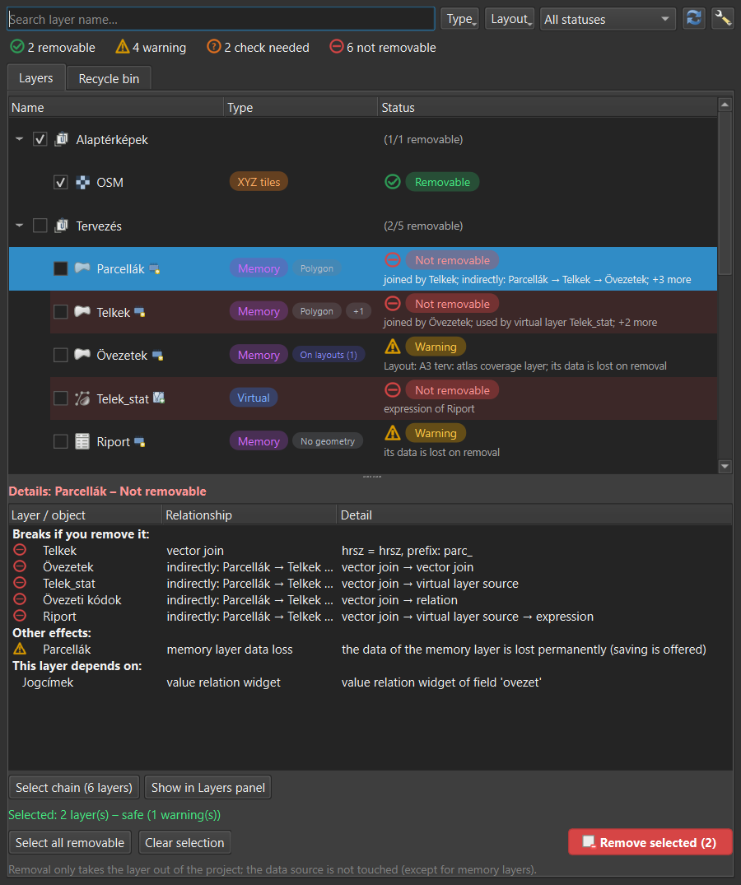
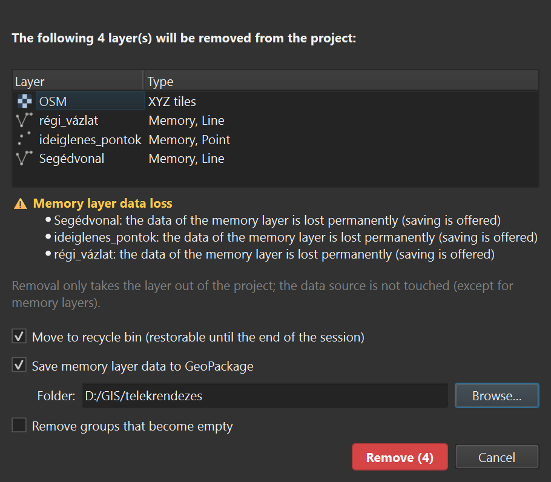
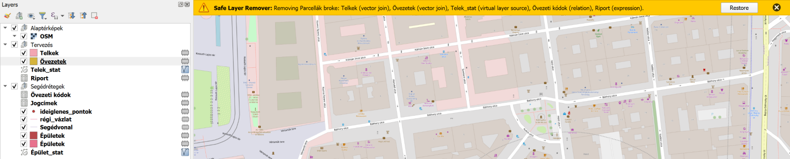

# Safe Layer Remover for QGIS

Removing a layer in QGIS is easy. Finding out afterwards that it was the join target of three other
layers, the source of a virtual layer and the atlas of your print layout is less fun.

This plugin lists every layer of the project, shows what depends on what, and only lets you remove
layers whose removal doesn't break anything else.



## What it checks

- joins, virtual layers (declared sources and table names in the SQL), relations, value relation and
  relation reference widgets, layer dependencies, group layers
- expressions that point to other layers (`get_feature`, `aggregate`, `overlay_*`, …) in expression
  fields, defaults, constraints, map tips, actions, symbology and labels
- print layouts: locked layer sets, maps following a map theme, legends, attribute tables, atlas
  coverage
- memory layers (data loss) and unsaved edits

Indirect effects are followed too: if C uses A and A uses B, removing B breaks C. Several layers can be
removed together when they only depend on each other ("Select chain").

The "Untouched only" filter lists the layers you can drop without breaking anything: nothing depends
on them, they are not on a layout and they have no unsaved edits. Memory layers count as untouched too
(saving their data is offered when you remove them), and so do layers that are only part of map themes.
The map themes a layer is visible in are shown as a badge and in the details; this can be turned off.

You can also lock layers yourself (right click › Lock, the Lock button or Ctrl+L, also in the Layers
panel context menu). Locked layers get a padlock and can't be removed until you unlock them; the lock
is saved in the project. Select several rows with Ctrl or Shift.



Removed layers go to a recycle bin and can be restored, memory layer data included. Undo brings the
layer back with its original id and in its old place, together with the joins, relations, map theme
entries and layout maps that QGIS dropped when it was removed. If you remove something from the normal
Layers panel that breaks other layers, the plugin notices and offers to put it back. Layers that others
depend on get a small marker in the Layers panel.

There's also an option (off by default) to make *every* layer removal undoable, including the ones you
do in the Layers panel. The recycle bin lives in a temporary folder on disk, not in memory, and is
cleared when QGIS closes or another project is opened. It keeps the last 50 items, and memory layers
above 200 000 features keep only their definition; both limits can be changed in the settings.



The UI is English, or Hungarian on a Hungarian QGIS.

## Install

Download `safe_layer_remover.zip` from the
[latest release](https://github.com/danzig666/qgis-safe-layer-remover/releases/latest) and use
*Plugins › Manage and Install Plugins › Install from ZIP*.

Works with QGIS 3.34 and newer, including QGIS 4 (Qt6).

## Tests

```
python-qgis.bat safe_layer_remover/tests/run_tests.py
```

`tests/build_demo_project.py` builds a small project with every kind of dependency, handy for trying
things out.

## License

GPL-2.0-or-later
